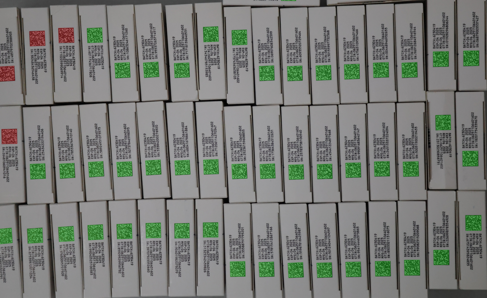
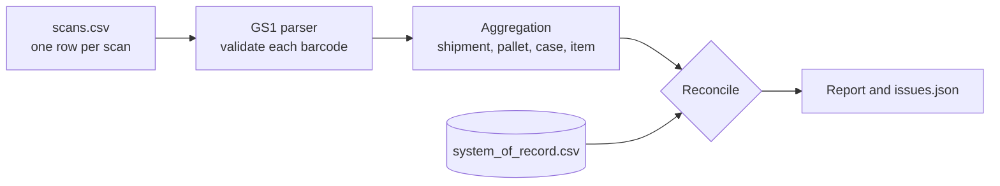

# GS1 Serialization Demo

Parse and validate GS1 barcodes, aggregate scanned items into case and pallet hierarchies, and reconcile what was scanned against a system of record. Everything runs on synthetic data with no dependencies.

> This is a clean-room demonstration built from the public GS1 specifications. The code is not client code, and all the data it processes is synthetic: GTINs use the 950 prefix, serial numbers are sequential and lots are random. The photo in the next section is a separate illustration of a decoder's output.

## Where the barcode text comes from



*An example decoder response on a bulk scan of cartons. Green marks a code that was read, red marks one that was not.*

The demo starts one step after this. It takes the text a decoder returns for each code, then validates, aggregates and reconciles it.

## What it shows

- **GS1 parsing and validation.** Application identifiers 01 (GTIN), 10 (lot), 11 (production date), 17 (expiry) and 21 (serial). GTIN check digits, real-date checks (day `00` means end of month), allowed characters and length limits. Both the bracketed form and the machine-readable form with the GS separator are accepted.
- **Aggregation.** Scan events become a `shipment > pallet > case > item` hierarchy keyed by SGTIN (GTIN plus serial). Duplicate scans and items scanned into two cases are caught as they arrive.
- **Three-way reconciliation.** Scanned data, the aggregated hierarchy and a system-of-record extract are compared, and every disagreement is reported with the shipment, case and SGTIN involved.
- **A way to prove it works.** The generator injects a known number of each error type, and a test checks that the reconciliation finds exactly those.

## Quick start

Requires Python 3.9 or newer. Nothing to install.

```bash
# macOS or Linux
./run.sh

# Windows
run.bat
```

Other options:

| Command | What it does |
|---|---|
| `run.bat test` or `./run.sh test` | Runs the unit tests |
| `run.bat scale` or `./run.sh scale` | Generates and reconciles 500 synthetic shipments (48,000 items) |
| `python -m gs1demo parse "<barcode>"` | Parses and validates a single barcode |
| `python -m gs1demo generate --shipments 100 --seed 3` | Writes a new synthetic data set |

## Sample output

```
GS1 serialization demo: reconciliation report
==============================================
Shipments           20
Scan rows read      1922
Items in record     1920
Items scanned       1916
Items matched       1913

Issues by kind
  unreadable_barcode             3
  duplicate_scan                 3
  scanned_in_multiple_cases      0
  missing_from_scan              7
  unexpected_item                3
  hierarchy_mismatch             3
  lot_mismatch                   2
  expiry_mismatch                2

Shipments needing attention: 10 of 20
Clean shipments:             10
```

Parsing a barcode whose check digit is wrong:

```
$ python -m gs1demo parse "(01)09506000134353(17)271231(10)A1B2C3(21)10000001"
(01) GTIN             09506000134353
(17) Expiry date      271231
(10) Batch/Lot        A1B2C3
(21) Serial number    10000001
Expiry: 2027-12-31
ERROR  (01) GTIN: check digit should be 2, found 3
```

## How it works



The three views being compared:

| View | Source in this demo |
|---|---|
| Scanned | `sample_data/scans.csv`, one barcode per row with the pallet and case being packed |
| Aggregated | Built in memory from the scans by `gs1demo/aggregation.py` |
| System of record | `sample_data/system_of_record.csv`, standing in for a serialization platform or ERP extract |

### Issue kinds

| Kind | Meaning |
|---|---|
| `unreadable_barcode` | The barcode failed GS1 validation, so no SGTIN could be read |
| `duplicate_scan` | The same SGTIN was scanned twice into the same case |
| `scanned_in_multiple_cases` | The same SGTIN was scanned into two different cases |
| `missing_from_scan` | The record expects the item but no valid scan matches it |
| `unexpected_item` | A valid scan has no matching row in the record |
| `hierarchy_mismatch` | The item was scanned into a different case or pallet than the record says |
| `lot_mismatch` | The lot in the barcode differs from the record |
| `expiry_mismatch` | The expiry in the barcode differs from the record |

An unreadable barcode also leaves its record item unmatched, so each one shows up twice, once as `unreadable_barcode` and once as `missing_from_scan`.

## Using a real barcode decoder

The demo reads barcode text from a CSV. In a live line, a decoder (a commercial SDK, a handheld scanner or a camera pipeline) turns a scan into that same text. The only integration point is the `barcode` string passed to `parse_gs1`, so a decoder only needs to produce a string and a case and pallet context.

## Project layout

```
gs1demo/
  parser.py        GS1 parsing and validation
  aggregation.py   scans to shipment > pallet > case > item
  reconcile.py     three-way comparison and report data
  generate.py      synthetic data with injected errors
  cli.py           command line interface
sample_data/       generated scans, record and expected issue counts
tests/             unit and end-to-end tests
run.sh, run.bat    one-command runners
```

## Tests

```bash
run.bat test        # or ./run.sh test
```

Twelve tests cover the parser (check digits, dates, both input forms, junk input), the aggregation rules, and an end-to-end check that reconciliation reports exactly the errors the generator injected, for two different seeds and sizes, plus a clean-data case.

## Limits

- Identifiers outside 01, 10, 11, 17 and 21 are reported as unsupported.
- Years in dates are read as 20YY.
- The record is a CSV, and there is no database or network access.
